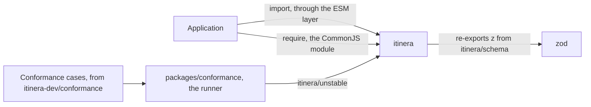
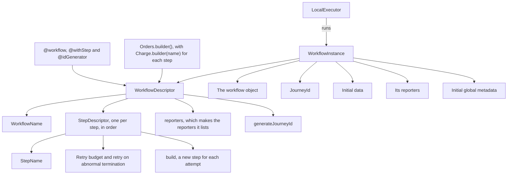
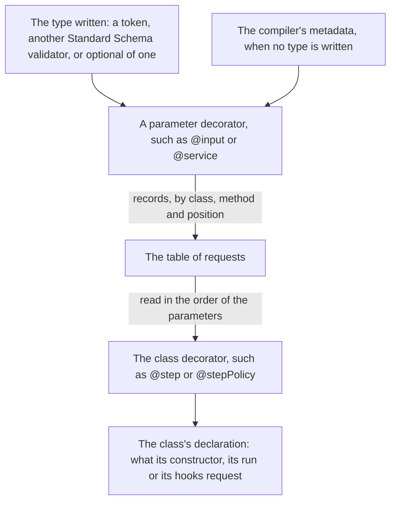
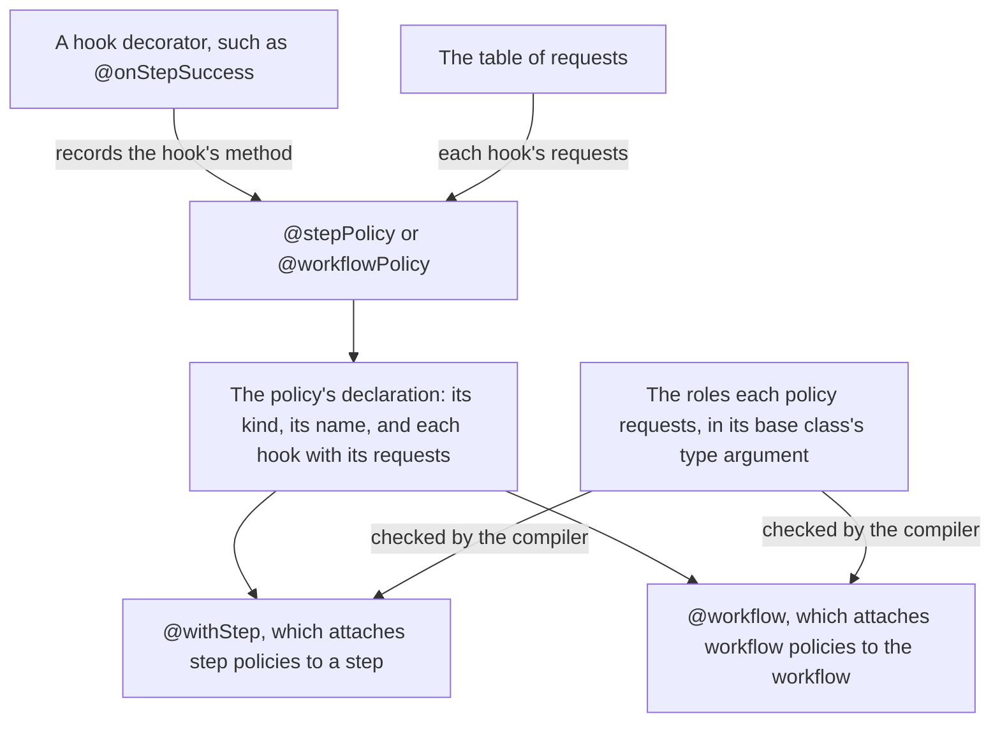
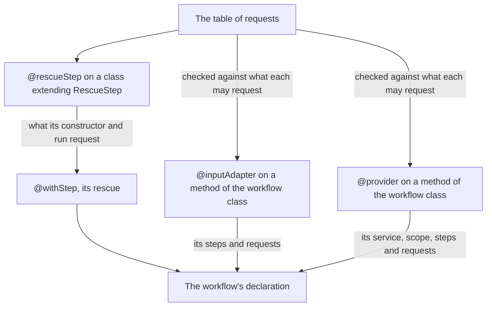
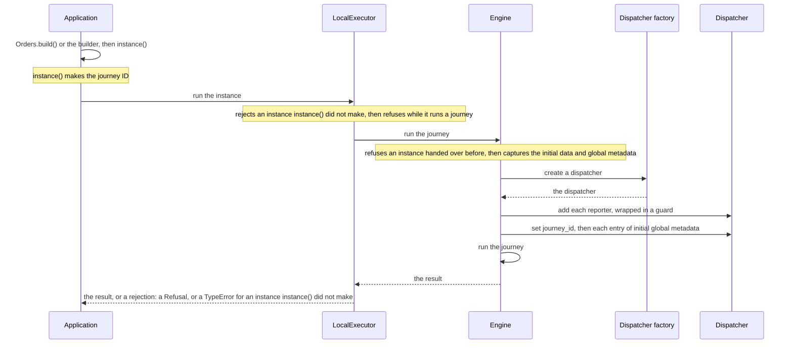
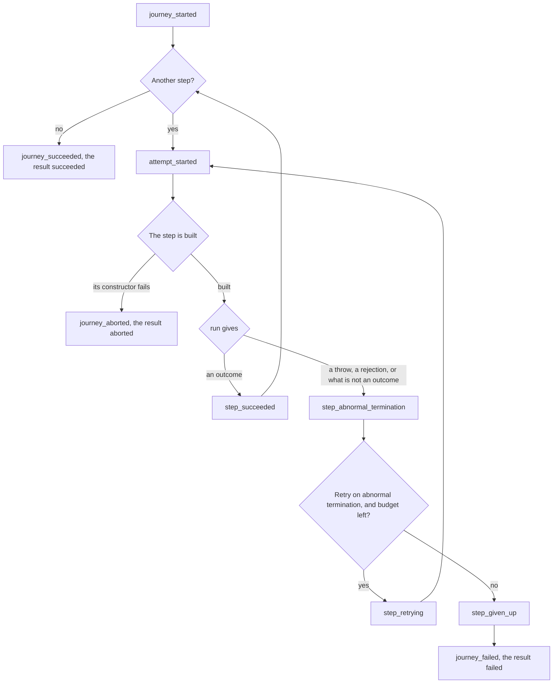
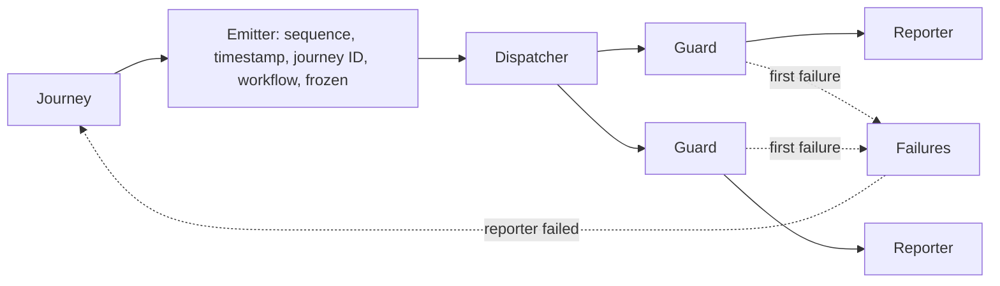

# Architecture

How itinera-ts is put together, and how it runs a journey. Stage 3 of the [tier 1 plan](tier-1-plan.md) starts this document, and each later stage adds the sections of what it builds, so it never describes anything ahead of the code.

Every diagram is followed by a numbered list that says everything it shows, and by the places in the code where that part lives. The words are those of the [specification](https://github.com/itinera-dev/spec), chapter 1, and the TypeScript names are those of the code. Why each part is shaped the way it is, is decided in the tier 1 plan and the tech specs under [specs](specs/).

## Tier 1

Tier 1 runs a journey in one process, with steps, retries, rescue steps, policies and their hooks, roles, input adapters, services, events and reporters. So far, a journey runs steps that succeed or terminate abnormally, with retries of abnormal terminations, events and reporters.

### The packages

1. An application depends on one package, `itinera`, and imports each concept from a subpath of it. The package root exports nothing of its own.
2. Each subpath is a CommonJS module with an ESM layer that only re-exports it, so `import` and `require` reach the same copy.
3. Until a proposal is listed in `conformance.json`, its API is exported only from `itinera/unstable`. The only other subpath for now is `itinera/schema`, which re-exports Zod's `z`, on which itinera's type tokens are built, so an application uses the same copy of Zod as itinera.
4. `packages/conformance`, which is never published, runs the conformance cases of [itinera-dev/conformance](https://github.com/itinera-dev/conformance) against `itinera`, through `itinera/unstable`, as an application imports it. It puts each scenario's workflow together with the builder from test support's step mocks, runs it with `LocalExecutor`, and reads what the journey did from recording reporters.

The modules of `packages/itinera/src`, each the module of one concept:

| Module | Holds |
|---|---|
| `value` | `Value`, `PlainValue`, `SerialisesItself` and `AsValue`, the private capture that checks and copies a value, and the type tokens a request names, with `optional`, `classOf` and `guard` |
| `schema` | Zod's `z`, re-exported |
| `option` | `Option`, `Some` and `None` |
| `event` | `Event`, every kind of event and what each carries |
| `report` | Reporters, dispatchers and their factories, `DefaultDispatcher`, `DebugReporter` |
| `journey` | Journey IDs, abort reasons and failure causes, the result, its statuses, failures and aborts, the data bag, `Contributor` and `@contributor`, `@journeyId` and `@dataBag` |
| `step` | Step names, reasons, `Step` and `@step`, `RescueStep`, `@rescueStep` and `@fromRescuedStep`, `@input`, `@stepReporter` and `StepReporter`, the requests of a step hook about its step, `@stepName`, `@attempt`, `@failureReason` and `@error`, outcomes, attempts, step descriptors, their options and their builders |
| `workflow` | `Workflow`, `@workflow`, `@withStep`, `@idGenerator`, `@fromWorkflow`, `@inputAdapter`, `@key` and what an adapter returns, the builder, workflow descriptors, violations, the names of workflows and adapters, and the types of the request decorators, which it re-exports from `declaration` |
| `instance` | `WorkflowInstance` and what an instance holds besides its initial data |
| `executor` | `LocalExecutor`, `Refusal` and why `run` refuses an instance |
| `policy` | `StepPolicy`, `WorkflowPolicy`, `@stepPolicy` and `@workflowPolicy`, the hooks' decorators, what a hook returns, the requests only hooks make, `@fromStep`, `@role`, `@failureCause`, `@retryCause` and `@hookReporter`, the roles a list of policies requests, and the names and closed sets events carry about policies and hooks |
| `service` | Provider names, service types and `@service`, `@provider`, what a provider returns, `@providerReporter` and `ProviderReporter` |
| `testing` | Test support: `RecordingReporter`, `Ending`, `stepMock` and `StepMock` |
| `engine` | Private: runs one journey, from what comes before it to its result |
| `closed-set` | `closedSet`, `ClosedSet`, `EveryValue` and `ValueOf`, from which every closed set of names is declared |
| `name` | Private: `named`, which refuses an empty name as something is declared |
| `declaration` | Private: the table of the requests parameter decorators record, the types of the request decorators, the types read from the metadata, the check that the compiler recorded it, and the guard that refuses to compile without `strictNullChecks` |
| `index` | The package root, which exports nothing of its own |
| `unstable` | The subpath `itinera/unstable`, which re-exports the API of the proposals not listed yet |

Where it lives: `packages/`, and each module in `packages/itinera/src/`, with its submodules in the directory of its name.

### What a workflow is made of

1. A `WorkflowDescriptor` is the workflow's declaration, its own object beside the workflow object. The decorators fill the lists the builder reads, and the builder also puts a workflow together without decorators, taking each step from a step builder that the step class's `builder(name)` starts; either way, `build()` checks it and makes it.
2. It holds the workflow's name and its step descriptors in the order they run. Its `reporters` makes a new reporter of each class the workflow lists, and its `generateJourneyId` asks the ID generator for a journey ID, or makes a random UUID when the workflow has none.
3. Each `StepDescriptor` holds the step's name, its retry budget, whether it retries an abnormal termination, which it does unless that is turned off, and `build`, which makes a new step for each attempt.
4. A `WorkflowInstance` holds the descriptor beside the workflow object, the journey ID, the initial data, the reporters made for this journey, the workflow's first and the instance's own after them, and the initial global metadata.
5. The local executor runs an instance, reading only what `WorkflowInstance` holds.
6. All three are sealed: only the decorators, the builder and `instance()` make them, so one written by hand does not compile where one is expected.

Where it lives: `workflow/decorators.ts`, `workflow/id-generator.ts`, `workflow/builder.ts`, `step/builder.ts`, `workflow/descriptor.ts`, `workflow/registry.ts`, `step/descriptor.ts`, `instance.ts`.

### How requests are declared

1. Each parameter decorator records one request in a private table, keyed by the class, the method, or `undefined` for the constructor, and the parameter's position. A parameter carrying two requests is refused at once.
2. A request for a value takes its type from what it is given: one of the tokens, any other Standard Schema validator, or either wrapped in `optional`. With no type given, it reads the parameter's declared type from the metadata the compiler records, which says only `number`, `string`, `boolean` or a class that serialises itself; anything else is refused when the class is defined.
3. The types of the decorators refuse at compile time a request in a place that may not make it, and a parameter whose declared type does not accept what the request gives. Without the compiler option `strictNullChecks`, `null` would belong to every type and these refusals would compile, so then no request decorator compiles.
4. The class decorator reads the table for its constructor and its methods, in the order of their parameters, counted from the metadata or the function's length, and refuses a parameter that carries no request. What it gathers is the class's declaration: for a step, what its constructor needs and what its `run` takes; for a policy, what each of its hooks requests. Later stages resolve these requests when a step is built and run, and when a hook is called.

Where it lives: `declaration.ts`, `declaration/request.ts`, `declaration/parameter.ts`, `declaration/metadata.ts`, `value/token.ts`, `step/request.ts`, `step/declared.ts`, `journey/contributor.ts`, `journey/request.ts`, `service/request.ts`, `service/provider.ts`, `service/reporter.ts`, `workflow/request.ts`, `workflow/adapter.ts`, `step/rescue.ts`, `policy/request.ts`, `policy/reporter.ts`.

### How policies are declared

1. A hook decorator marks the method of a policy class that implements its hook, and compiles only on a method of the right kind of policy that returns what its hook may return: `OnSuccess` for `on step success`, `OnFailure` for the other step hooks, and nothing for the workflow hooks. One hook on two methods, or two hooks on one method, is refused when the class is defined.
2. The parameter decorators record each hook's requests in the table of requests, as for a step.
3. `@stepPolicy` or `@workflowPolicy` gathers the policy's kind, its name, the class's name unless one is given, and each hook with its requests. It refuses, when the class is defined, a policy that defines no hook, a method that carries requests but no hook, and a cause requested by a hook that is not given it.
4. `@withStep` attaches step policies to its step, and `@workflow` workflow policies to the workflow, each refusing a policy not declared with its decorator, including a policy of the other kind given through a cast. A policy names the roles it requests as its base class's type argument, so both compile only on a workflow class that implements every role their policies request. Nothing about roles exists at run time.

Where it lives: `policy/hooks.ts`, `policy/declared.ts`, `policy/step-policy.ts`, `policy/workflow-policy.ts`, `policy/lifecycle.ts`, `policy/roles.ts`, `workflow/decorators.ts`, `workflow/registry.ts`, `step/descriptor.ts`.

### How rescue steps, input adapters and providers are declared

1. `@rescueStep` gathers what a rescue step's constructor and its `run` request, as `@step` does for a step, and `@withStep` attaches a rescue step declared with it to its step, through `rescue`.
2. `@inputAdapter` and `@provider` mark methods of the workflow class. Each reads its method's requests from the table of requests, refuses at once a request it may not make, and adds the adapter or the provider, with its name, the steps it serves and its requests, to the workflow's declaration, beside its steps, its policies and its ID generator. `@workflow` then refuses any method that carries requests but is marked with neither.
3. An input adapter returns `this.supply(value)` or `this.fromDataBag()`, and a provider `this.provide(instance)` or `this.provide(instance, data)`, helpers of `Workflow`; what they make is recorded, so what a cast lets through is told apart from them. Later stages call them while a step is built.

Where it lives: `step/rescue.ts`, `workflow/adapter.ts`, `service/provider.ts`, `service/reporter.ts`, `workflow/registry.ts`, `workflow/decorators.ts`, `workflow.ts`, `step/descriptor.ts`, `declaration.ts`.

### From declaration to result

1. The application makes the workflow object with `Orders.build()`, or with the builder, and asks it for an instance. `instance()` makes the journey ID, from the ID generator or as a random UUID.
2. The application hands the instance to `run` on a `LocalExecutor`. The executor rejects with a `TypeError` an instance that `instance()` did not make, which only a cast lets through. While it runs a journey, it refuses any other.
3. The engine refuses an instance that was handed to `run` before, refused or not. It captures the initial data and the initial global metadata, and refuses the instance when a value is not a value, or when the global metadata sets `journey_id`.
4. It creates the journey's dispatcher with the executor's dispatcher factory, the default one unless the executor was given another, and adds each reporter of the instance, wrapped in a guard.
5. It sets `journey_id` first, then each entry of the initial global metadata, in order, through the dispatcher.
6. A failure of the factory, of the dispatcher or of a reporter in steps 4 and 5 refuses the instance. A refusal rejects `run` with a `Refusal`, before any journey and any event.
7. Then the engine runs the journey, as the next section shows, and `run` resolves to its result: succeeded or failed with its data bag, or aborted.

Where it lives: `executor.ts`, `executor/refusal.ts`, `engine.ts`, `engine/start.ts`.

### How a journey runs

1. The engine emits `journey_started`, carrying the keys of the initial data, then attempts each step in the order the workflow declares them.
2. Each attempt emits `attempt_started`, then builds the step with its descriptor's `build`. A constructor that throws aborts the journey with `step could not be built`.
3. The engine awaits the step's `run`, synchronous or asynchronous. An outcome made by the step's helpers emits `step_succeeded`, and the engine goes on to the next step.
4. A throw, a rejected promise, or anything returned that is not an outcome made by the helpers, is an abnormal termination, and emits `step_abnormal_termination` with the error's message.
5. The engine then decides by its own rule. While the step retries abnormal terminations and its retry budget allows another attempt, it emits `step_retrying` and attempts the step again.
6. Otherwise it emits `step_given_up`, with the cause `abnormal termination` when the step has no budget or does not retry abnormal terminations, and `retries exhausted` when its budget is spent. Then it emits `journey_failed`, and the result is failed, with the error as it was thrown.
7. Once every step succeeded, it emits `journey_succeeded`, and the result is succeeded.
8. An abort, from a step that cannot be built or a reporter that fails, ends the journey at once: the engine emits `journey_aborted`, and the result is aborted, with no data bag.

Where it lives: `engine/scan.ts`, `engine/decision.ts`, `engine.ts`, `step/outcome.ts`, `journey/result.ts`.

### Events and reporters

1. The journey makes each event with its emitter, which numbers the events of the journey from 1, stamps each with the time in ISO 8601 UTC, gives each the journey ID and the workflow's name, and freezes it with everything it carries.
2. It hands the event to the journey's dispatcher, which delivers it to each reporter through that reporter's guard, in the order the dispatcher chooses.
3. A guard passes on the failure of its reporter, and records it in the journey's failures, where the first failure stands.
4. When the dispatcher fails, or a reporter failed even though the dispatcher swallowed the failure, the journey is aborted with `reporter failed`, naming the step being run, if any.
5. Once a reporter failed, the guards let nothing through but `journey_aborted`, and nothing at all to a reporter that failed. A failure while `journey_aborted` is delivered is ignored, so it reaches the reporters after it.
6. Global metadata goes through the same guards, before the journey starts.

Where it lives: `engine/journey.ts`, `engine/emitter.ts`, `engine/guard.ts`, `engine/frozen.ts`, `report/default-dispatcher.ts`.
