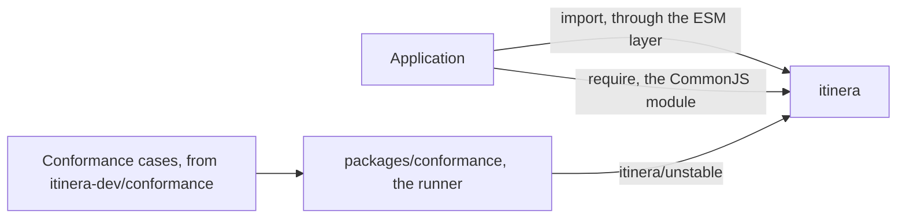
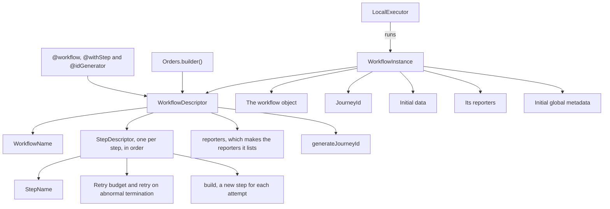
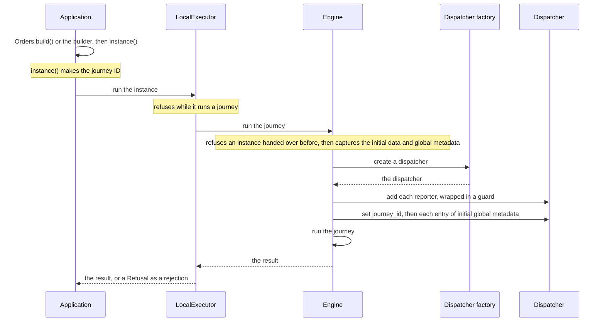
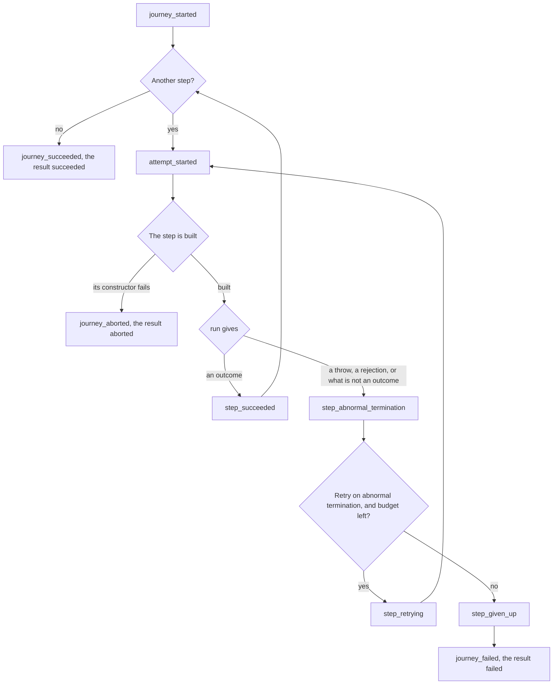
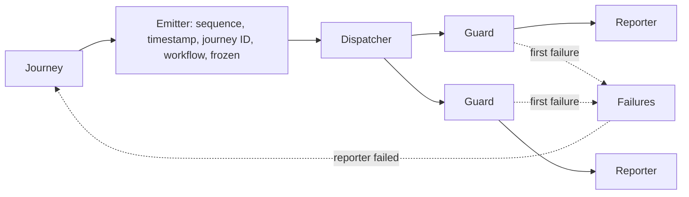

# Architecture

How itinera-ts is put together, and how it runs a journey. Stage 3 of the [tier 1 plan](tier-1-plan.md) starts this document, and each later stage adds the sections of what it builds, so it never describes anything ahead of the code.

Every diagram is followed by a numbered list that says everything it shows, and by the places in the code where that part lives. The words are those of the [specification](https://github.com/itinera-dev/spec), chapter 1, and the TypeScript names are those of the code. Why each part is shaped the way it is, is decided in the tier 1 plan and the tech specs under [specs](specs/).

## Tier 1

Tier 1 runs a journey in one process, with steps, retries, rescue steps, policies and their hooks, roles, input adapters, services, events and reporters. So far, a journey runs steps that succeed or terminate abnormally, with retries of abnormal terminations, events and reporters.

### The packages

1. An application depends on one package, `itinera`, and imports each concept from a subpath of it. The package root exports nothing of its own.
2. Each subpath is a CommonJS module with an ESM layer that only re-exports it, so `import` and `require` reach the same copy.
3. Until a proposal is listed in `conformance.json`, its API is exported only from `itinera/unstable`, which is the only subpath for now.
4. `packages/conformance`, which is never published, runs the conformance cases of [itinera-dev/conformance](https://github.com/itinera-dev/conformance) against `itinera`, through `itinera/unstable`, as an application imports it. It puts each scenario's workflow together with the builder from test support's step mocks, runs it with `LocalExecutor`, and reads what the journey did from recording reporters.

The modules of `packages/itinera/src`, each the module of one concept:

| Module | Holds |
|---|---|
| `value` | `Value`, `PlainValue`, `SerialisesItself` and `AsValue`, and the private capture that checks and copies a value |
| `option` | `Option`, `Some` and `None` |
| `event` | `Event`, every kind of event and what each carries |
| `report` | Reporters, dispatchers and their factories, `DefaultDispatcher`, `DebugReporter` |
| `journey` | Journey IDs, abort reasons and failure causes, the result, its statuses, failures and aborts, the data bag |
| `step` | Step names, reasons, `Step` and `@step`, outcomes, attempts, step descriptors and their options |
| `workflow` | `Workflow`, `@workflow`, `@withStep`, `@idGenerator`, the builder, workflow descriptors, violations, the names of workflows and adapters |
| `instance` | `WorkflowInstance` and what an instance holds besides its initial data |
| `executor` | `LocalExecutor`, `Refusal` and why `run` refuses an instance |
| `policy`, `service` | The names and closed sets events carry about policies, hooks and providers |
| `testing` | Test support: `RecordingReporter`, `Ending`, `stepMock` and `StepMock` |
| `engine` | Private: runs one journey, from what comes before it to its result |
| `closed-set` | `closedSet`, `ClosedSet`, `EveryValue` and `ValueOf`, from which every closed set of names is declared |
| `name` | Private: `named`, which refuses an empty name as something is declared |
| `declaration` | Private: the check that the compiler recorded the types of a decorated method's parameters |
| `index` | The package root, which exports nothing of its own |
| `unstable` | The subpath `itinera/unstable`, which re-exports the API of the proposals not listed yet |

Where it lives: `packages/`, and each module in `packages/itinera/src/`, with its submodules in the directory of its name.

### What a workflow is made of

1. A `WorkflowDescriptor` is the workflow's declaration, its own object beside the workflow object. The decorators fill the lists the builder reads, and the builder also puts a workflow together without decorators; either way, `build()` checks it and makes it.
2. It holds the workflow's name and its step descriptors in the order they run. Its `reporters` makes a new reporter of each class the workflow lists, and its `generateJourneyId` asks the ID generator for a journey ID, or makes a random UUID when the workflow has none.
3. Each `StepDescriptor` holds the step's name, its retry budget, whether it retries an abnormal termination, which it does unless that is turned off, and `build`, which makes a new step for each attempt.
4. A `WorkflowInstance` holds the descriptor beside the workflow object, the journey ID, the initial data, the reporters made for this journey, the workflow's first and the instance's own after them, and the initial global metadata.
5. The local executor runs an instance. It reads only the `WorkflowInstance` interface, so it runs any instance, however it was made.

Where it lives: `workflow/decorators.ts`, `workflow/builder.ts`, `workflow/descriptor.ts`, `workflow/registry.ts`, `step/descriptor.ts`, `instance.ts`.

### From declaration to result

1. The application makes the workflow object with `Orders.build()`, or with the builder, and asks it for an instance. `instance()` makes the journey ID, from the ID generator or as a random UUID.
2. The application hands the instance to `run` on a `LocalExecutor`. While the executor runs a journey, it refuses any other.
3. The engine refuses an instance that was handed to `run` before, refused or not. It captures the initial data and the initial global metadata, and refuses the instance when a value is not a value, or when the global metadata sets `journey_id`.
4. It creates the journey's dispatcher with the executor's dispatcher factory, the default one unless the executor was given another, and adds each reporter of the instance, wrapped in a guard.
5. It sets `journey_id` first, then each entry of the initial global metadata, in order, through the dispatcher.
6. A failure of the factory, of the dispatcher or of a reporter in steps 4 and 5 refuses the instance. A refusal rejects `run` with a `Refusal`, before any journey and any event.
7. Then the engine runs the journey, as the next section shows, and `run` resolves to its result: succeeded or failed with its data bag, or aborted.

Where it lives: `executor.ts`, `executor/refusal.ts`, `engine.ts`, `engine/start.ts`.

### How a journey runs

1. The engine emits `journey_started`, carrying the keys of the initial data, then attempts each step in the order the workflow declares them.
2. Each attempt emits `attempt_started`, then builds the step with its descriptor's `build`. A constructor that throws aborts the journey with `step could not be built`.
3. The engine awaits the step's `run`, synchronous or asynchronous. An outcome made by the step's helpers emits `step_succeeded`, and the engine goes on to the next step.
4. A throw, a rejected promise, or anything returned that is not an outcome made by the helpers, is an abnormal termination, and emits `step_abnormal_termination` with the error's message.
5. The engine then decides by its own rule. While the step retries abnormal terminations and its retry budget allows another attempt, it emits `step_retrying` and attempts the step again.
6. Otherwise it emits `step_given_up`, with the cause `abnormal termination` when the step has no budget or does not retry abnormal terminations, and `retries exhausted` when its budget is spent. Then it emits `journey_failed`, and the result is failed, with the error as it was thrown.
7. Once every step succeeded, it emits `journey_succeeded`, and the result is succeeded.
8. An abort, from a step that cannot be built or a reporter that fails, ends the journey at once: the engine emits `journey_aborted`, and the result is aborted, with no data bag.

Where it lives: `engine/scan.ts`, `engine/decision.ts`, `engine.ts`, `step/outcome.ts`, `journey/result.ts`.

### Events and reporters

1. The journey makes each event with its emitter, which numbers the events of the journey from 1, stamps each with the time in ISO 8601 UTC, gives each the journey ID and the workflow's name, and freezes it with everything it carries.
2. It hands the event to the journey's dispatcher, which delivers it to each reporter through that reporter's guard, in the order the dispatcher chooses.
3. A guard passes on the failure of its reporter, and records it in the journey's failures, where the first failure stands.
4. When the dispatcher fails, or a reporter failed even though the dispatcher swallowed the failure, the journey is aborted with `reporter failed`, naming the step being run, if any.
5. Once a reporter failed, the guards let nothing through but `journey_aborted`, and nothing at all to a reporter that failed. A failure while `journey_aborted` is delivered is ignored, so it reaches the reporters after it.
6. Global metadata goes through the same guards, before the journey starts.

Where it lives: `engine/journey.ts`, `engine/emitter.ts`, `engine/guard.ts`, `engine/frozen.ts`, `report/default-dispatcher.ts`.
