# Architecture

How itinera-ts is put together, and how it runs a journey. Stage 3 of the [tier 1 plan](tier-1-plan.md) starts this document, and each later stage adds the sections of what it builds, so it never describes anything ahead of the code.

Every diagram is followed by a numbered list that says everything it shows, and by the places in the code where that part lives. The words are those of the [specification](https://github.com/itinera-dev/spec), chapter 1, and the TypeScript names are those of the code. Why each part is shaped the way it is, is decided in the tier 1 plan and the tech specs under [specs](specs/).

## Tier 1

Tier 1 runs a journey in one process, with steps, retries, rescue steps, policies and their hooks, roles, input adapters, services, events and reporters. So far, a journey builds each step from its inputs, read from the data bag or supplied by its input adapter, lends it the services its service providers make, runs steps that succeed, fail, skip or terminate abnormally, retries them, rescues them or gives them up, calls the hooks of its policies around each decision, with the workflow object as the roles they request, aborts when something illegal happens, with events and reporters, and ends with a result whose output the application reads.

### The packages

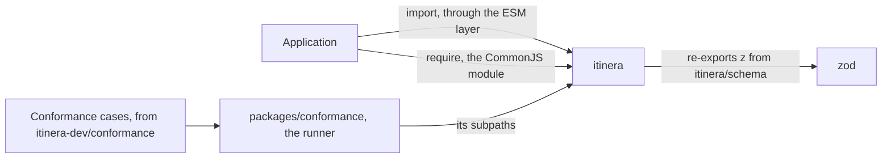

1. An application depends on one package, `itinera`, and imports each concept from a subpath of it. The package root exports nothing of its own.
2. Each subpath is a CommonJS module with an ESM layer that only re-exports it, so `import` and `require` reach the same copy.
3. The subpaths are those of the concepts: `itinera/event`, `itinera/executor`, `itinera/instance`, `itinera/journey`, `itinera/option`, `itinera/policy`, `itinera/report`, `itinera/service`, `itinera/step`, `itinera/value` and `itinera/workflow`, and `itinera/schema`, which re-exports Zod's `z`, on which itinera's type tokens are built, so an application uses the same copy of Zod as itinera. Until a proposal is listed in `conformance.json`, and while its API holds a stand-in or names API of a proposal not yet listed, its API is exported only from `itinera/unstable`, which holds nothing now, since test support has a subpath of its own, `itinera/testing`, which an application imports only in its tests.
4. `packages/conformance`, which is never published, runs the conformance cases of [itinera-dev/conformance](https://github.com/itinera-dev/conformance) against `itinera`, through its subpaths, test support from `itinera/testing` included, as an application imports it. It puts each scenario's workflow together with the builder from test support's step mocks and rescue step mocks, given their inputs, what a rescue step requests of the step it rescues, and their services, by position, each extended to call each service it is lent and to play what the step does before it ends, its input adapters from one method of the scenario's workflow class that plays their scripts, its service providers from one method of that class for each provider name, since nothing a provider requests says which provider it is, each making the runner's own labellers and meters, and its policies from test support's policy mocks, each extended to play what the hook does before it ends, with the scenario's workflow class providing every role, runs it with `LocalExecutor`, and reads what the journey did from recording reporters. For the converted types of the cases, a request or a read names `classOf` of a class of the runner's own whose `toValue()` and `fromValue` both throw, or a guard of its own that refuses every value, and an object of that class is given wherever a case captures one. For the sentences of test support, it gives the instance test support's recording reporter and fakes, writes and runs a scripted run, and calls a step, a hook or an input adapter alone with the handles test support's recorders lend. Its own features, under `packages/conformance/features/fixtures`, drive workflows written by hand in `src/fixture/`, declared with the decorators as an application writes them, through the cases' sentences.

The modules of `packages/itinera/src`, each the module of one concept:

| Module | Holds |
|---|---|
| `value` | The subpath `itinera/value`: `Value`, `PlainValue`, `SerialisesItself` and `AsValue`, the private capture that checks and copies a value, the private read that gives a requester its own copy checked by a schema, and the type tokens a request names, with `optional`, `classOf` and `guard` |
| `schema` | Zod's `z`, re-exported |
| `option` | The subpath `itinera/option`: `Option`, `Some` and `None` |
| `event` | The subpath `itinera/event`: `Event`, every kind of event and what each carries, and the types of a closed set of names, `ClosedSet`, `EveryValue` and `ValueOf`. It also holds, privately, the `Level` of an event a step or a hook emits, which only test support re-exports |
| `report` | The subpath `itinera/report`: reporters, dispatchers and their factories, `DefaultDispatcher`, `DebugReporter` |
| `journey` | The subpath `itinera/journey`: journey IDs, abort reasons and failure causes, the result, its statuses, failures and aborts, its output and `OutputError`, the data bag and what reading it gives, `Read`, `Contributor` and `@contributor`, `@journeyId` and `@dataBag` |
| `step` | The subpath `itinera/step`: step names, reasons, `Step` and `@step`, `RescueStep`, `@rescueStep` and `@fromRescuedStep`, `@input`, `@stepReporter` and `StepReporter`, the requests of a step hook about its step, `@stepName`, `@attempt`, `@failureReason` and `@error`, outcomes, attempts, step descriptors, their options and their builders |
| `workflow` | The subpath `itinera/workflow`: `Workflow`, `@workflow`, `@withStep`, `@idGenerator`, `@fromWorkflow`, `@inputAdapter`, `@key` and what an adapter returns, the builder, workflow descriptors, their listing, violations, the names of workflows and adapters, and the types of the request decorators, which it re-exports from `declaration` |
| `instance` | The subpath `itinera/instance`: `WorkflowInstance`, which only `instance()` makes, in the private `instance/made.ts`, and what an instance holds besides its initial data |
| `executor` | The subpath `itinera/executor`: `LocalExecutor`, `Refusal` and why `run` refuses an instance |
| `policy` | The subpath `itinera/policy`: `StepPolicy`, `WorkflowPolicy`, `@stepPolicy` and `@workflowPolicy`, the hooks' decorators, what a hook returns, the requests only hooks make, `@fromStep`, `@role`, `@failureCause`, `@retryCause` and `@hookReporter`, the roles a list of policies requests, policy descriptors and the policies' builders, and the names and closed sets events carry about policies and hooks |
| `service` | The subpath `itinera/service`: provider names, service types and `@service`, `@provider`, what a provider returns, `@providerReporter` and `ProviderReporter`, and, privately, how the implementation a provider made is named |
| `testing` | The subpath `itinera/testing`, test support: `RecordingReporter`, `EntryRecordingReporter`, `FailingReporter`, `Ending`, `stepMock` and `StepMock`, `RescueEnding`, `rescueStepMock` and `RescueStepMock`, `HookEnding`, `stepPolicyMock` and `StepPolicyMock`, `workflowPolicyMock` and `WorkflowPolicyMock`, `TestMistake` and `MistakeKind`, `fakeProvider`, `scripted` and the scripted run's record, the recorders `Contributions`, `StepEventReporter` and `HookEventReporter`, and `TestDataBag` |
| `engine` | Private: runs one journey, from what comes before it to its result |
| `closed-set` | `closedSet`, from which every closed set of names is declared, and its types, which `event` re-exports |
| `name` | Private: `named`, which refuses an empty name as something is declared |
| `declaration` | Private: the table of the requests parameter decorators record, the requests a builder is given by position, the types of the request decorators and of the requests given by position, the types read from the metadata, the check that the compiler recorded it, and the guard that refuses to compile without `strictNullChecks` |
| `index` | The package root, which exports nothing of its own |
| `unstable` | The subpath `itinera/unstable`, for the API of the proposals not listed yet, which holds nothing now |

Where it lives: `packages/`, and each module in `packages/itinera/src/`, with its submodules in the directory of its name.

### What a workflow is made of

```mermaid
flowchart TD
    accTitle: What a workflow descriptor and an instance hold
    accDescr: A workflow descriptor holds its name, its step descriptors in order, makes the reporters it lists, and generates journey IDs. A workflow descriptor also holds its workflow policies, keeps its input adapters and service providers private, asks the input adapter attached to a step for an input, asks the service provider serving a step for a service, and lists its steps without running anything. A step descriptor holds the step's name, its retry budget, whether it retries an abnormal termination, its step policies, and how to build the step, and keeps its rescue step and its requests private. Decorators and the builder, given a builder for each step or its own lists, both make the descriptor, after checking every violation. An instance holds the descriptor beside the workflow object, its journey ID, its initial data, its reporters and its initial global metadata, and the local executor runs it.
    decorators["@workflow, @withStep and @idGenerator"] --> descriptor["WorkflowDescriptor"]
    builder["Orders.builder(), with Charge.builder(name) for each step, or the builder's own lists"] --> descriptor
    descriptor --> name["WorkflowName"]
    descriptor --> steps["StepDescriptor, one per step, in order"]
    descriptor --> reporters["reporters, which makes the reporters it lists"]
    descriptor --> generator["generateJourneyId"]
    descriptor --> workflowPolicies["policies, its workflow policies"]
    descriptor --> adapters["Its input adapters and service providers, kept private"]
    descriptor --> adapt["adapt, which asks a step's input adapter for an input"]
    descriptor --> provide["provide, which asks the provider serving a step for a service"]
    descriptor --> listing["listing, each step with its position, policies, adapter, services and rescue section"]
    steps --> stepName["StepName"]
    steps --> budget["Retry budget and retry on abnormal termination"]
    steps --> stepPolicies["policies, its step policies"]
    steps --> stepPrivate["Its rescue step and its requests, kept private"]
    steps --> build["build, a new step for each attempt"]
    instance["WorkflowInstance"] --> descriptor
    instance --> workflow["The workflow object"]
    instance --> id["JourneyId"]
    instance --> data["Initial data"]
    instance --> ireporters["Its reporters"]
    instance --> metadata["Initial global metadata"]
    executor["LocalExecutor"] -->|"runs"| instance
```

1. A `WorkflowDescriptor` is the workflow's declaration, its own object beside the workflow object. The decorators fill the lists the builder reads, and the builder also puts a workflow together without decorators, taking each step from a step builder that the step class's `builder(name)` starts, and its policies, input adapters, service providers and reporters from its own lists; either way, `build()` checks it and makes it. The check, `violationsOf`, finds every violation of chapter 3, 3.6 that TypeScript does not refuse at compile time, twelve kinds, and `duplicate adapter name`, which the specification is adding, and `@workflow`, when the class is defined, or the builder's `build()`, before the workflow's constructor runs, throws them all at once as `Violations`.
2. It holds the workflow's name, its step descriptors in the order they run, and its workflow policies, as policy descriptors, and keeps its input adapters and service providers where only itinera's own modules read them. Its `reporters` makes a new reporter of each class the workflow lists, its `adapt` calls the input adapter attached to a step on the workflow object, with what the engine resolved its requests to, its `provide` calls the service provider serving a step under a key on the workflow object in the same way, and its `generateJourneyId` asks the ID generator for a journey ID, giving it a data bag of the initial data when it requests one, or makes a random UUID when the workflow has none. Its `listing()` gives each step's name, position, policies, input adapter, services with the provider serving each, and a rescue section for a step with a rescue step, reading only what it holds; the static `Orders.listing()` and the builder's `listing()` read it too, without a workflow object.
3. Each `StepDescriptor` holds the step's name, its retry budget, whether it retries an abnormal termination, which it does unless that is turned off, its step policies, and `build`, which makes a new step for each attempt, and keeps its rescue step and what the step's constructor and `run` request where only itinera's own modules read them.
4. A `WorkflowInstance` holds the descriptor beside the workflow object, the journey ID, the initial data, the reporters made for this journey, the workflow's first and the instance's own after them, and the initial global metadata.
5. The local executor runs an instance, reading only what `WorkflowInstance` holds.
6. All three are sealed: only the decorators, the builder and `instance()` make them, so one written by hand does not compile where one is expected.

Where it lives: `workflow/decorators.ts`, `workflow/id-generator.ts`, `workflow/builder.ts`, `step/builder.ts`, `workflow/descriptor.ts`, `workflow/descriptor/assemble.ts`, `workflow/violation.ts` and its submodules in `workflow/violation/`, `workflow/listing.ts`, `service/serving.ts`, `workflow/registry.ts`, `step/descriptor.ts`, `instance.ts`, `instance/made.ts`.

### How requests are declared

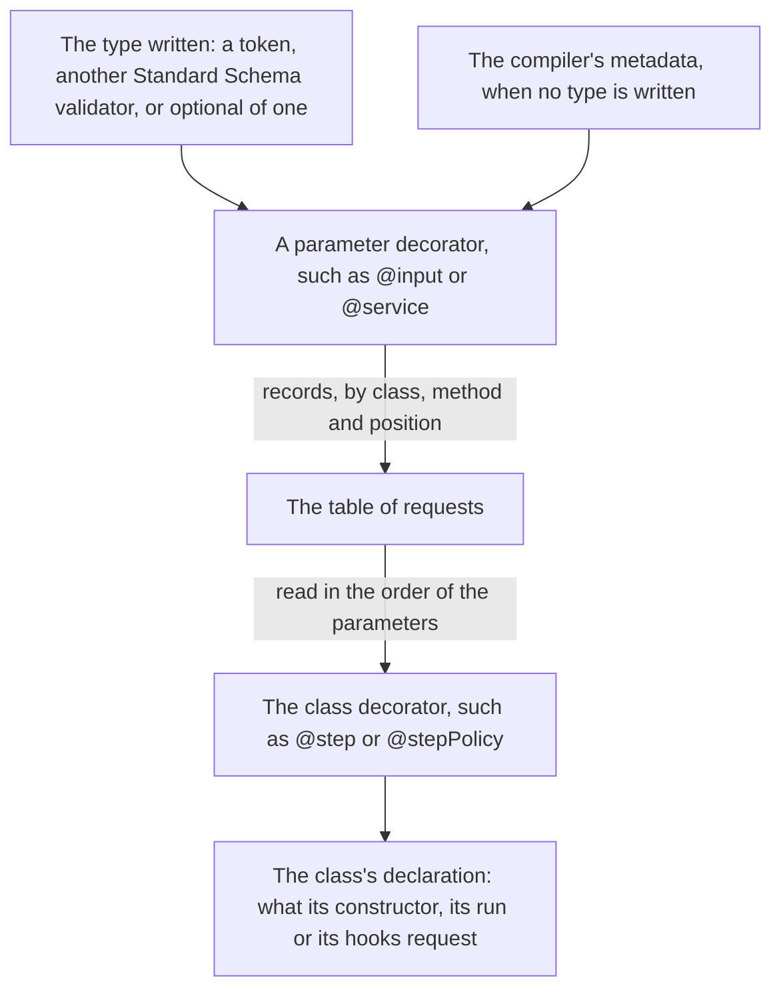

1. Each parameter decorator records one request in a private table, keyed by the class, the method, or `undefined` for the constructor, and the parameter's position. A parameter carrying two requests is refused at once.
2. A request for a value takes its type from what it is given: one of the tokens, any other Standard Schema validator, or either wrapped in `optional`. With no type given, it reads the parameter's declared type from the metadata the compiler records, which says only `number`, `string`, `boolean` or a class that serialises itself; anything else is refused when the class is defined.
3. The types of the decorators refuse at compile time a request in a place that may not make it, and a parameter whose declared type does not accept what the request gives. Without the compiler option `strictNullChecks`, `null` would belong to every type and these refusals would compile, so then no request decorator compiles.
4. The class decorator reads the table for its constructor and its methods, in the order of their parameters, counted from the metadata or the function's length, and refuses a parameter that carries no request. What it gathers is the class's declaration: for a step, what its constructor needs and what its `run` takes; for a policy, what each of its hooks requests. The engine resolves a step's constructor requests as it builds the step, and lends those of `run` as it runs it, as "How a journey runs" shows, and resolves a hook's as it calls the hook, as "How a hook is called" shows.
5. A class declared without decorators is given its requests by position, through a builder: each is a request decorator itself, such as `input("amount", integer)`, which remembers the request it stands for, so the builder gathers the same declaration without the table. Its type carries what the request gives and where it may be made, so a request that does not fit its parameter, or one left out, does not compile, and a request for a value must write its type, since no metadata is read there.

Where it lives: `declaration.ts`, `declaration/allowed.ts`, `declaration/marking.ts`, `declaration/token.ts`, `declaration/request.ts`, `declaration/parameter.ts`, `declaration/metadata.ts`, `value/token.ts`, `step/request.ts`, `step/declared.ts`, `journey/contributor.ts`, `journey/request.ts`, `service/request.ts`, `service/provider.ts`, `service/reporter.ts`, `workflow/request.ts`, `workflow/adapter.ts`, `step/rescue.ts`, `policy/request.ts`, `policy/reporter.ts`.

### How policies are declared

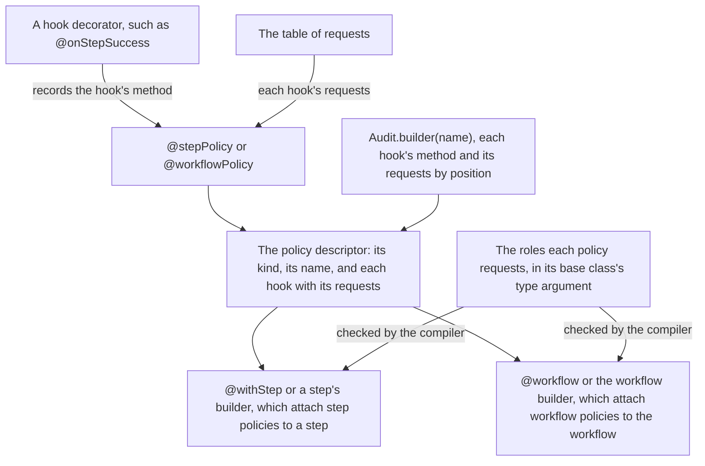

1. A hook decorator marks the method of a policy class that implements its hook, and compiles only on a method of the right kind of policy that returns what its hook may return: `OnSuccess` for `on step success`, `OnFailure` for the other step hooks, and nothing for the workflow hooks. One hook on two methods, or two hooks on one method, is refused when the class is defined.
2. The parameter decorators record each hook's requests in the table of requests, as for a step.
3. `@stepPolicy` or `@workflowPolicy` gathers the policy's kind, its name, the class's name unless one is given, and each hook with its requests. It refuses, when the class is defined, a policy that defines no hook, a method that carries requests but no hook, and a cause requested by a hook that is not given it.
4. For a policy class declared without decorators, a policy's builder, `Audit.builder(name)`, names the method of each hook with its requests by position, and checks at once what the decorators check when a class is defined. It is refused for a class declared with a policy's decorator, which is given as the class itself.
5. Either way the policy becomes a `PolicyDescriptor`, sealed as the other descriptors are, holding its name, the hooks it defines, how to build it and how to call each of its hooks.
6. `@withStep` and a step's builder attach step policies to a step, and `@workflow` and the workflow builder workflow policies to the workflow, each refusing a policy not declared with its decorator nor put together by a policy's builder, including a policy of the other kind given through a cast. A policy names the roles it requests as its base class's type argument, so each compiles only on a workflow class that implements every role their policies request. Nothing about roles exists at run time.

Where it lives: `policy/hooks.ts`, `policy/declared.ts`, `policy/descriptor.ts`, `policy/builder.ts`, `policy/step-policy/builder.ts`, `policy/workflow-policy/builder.ts`, `step/builder.ts`, `workflow/builder.ts`, `policy/step-policy.ts`, `policy/workflow-policy.ts`, `policy/lifecycle.ts`, `policy/roles.ts`, `workflow/decorators.ts`, `workflow/registry.ts`, `step/descriptor.ts`.

### How rescue steps, input adapters and providers are declared

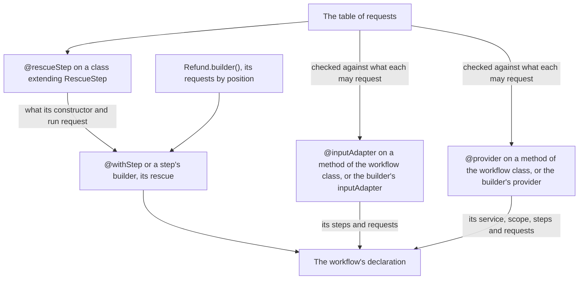

1. `@rescueStep` gathers what a rescue step's constructor and its `run` request, as `@step` does for a step, and `@withStep` attaches a rescue step declared with it to its step, through `rescue`. A step's builder takes one in its `rescue`, declared with `@rescueStep` or put together by a rescue step's builder, `Refund.builder()`, from its requests by position.
2. `@inputAdapter` and `@provider` mark methods of the workflow class. Each reads its method's requests from the table of requests, refuses at once a request it may not make, and adds the adapter or the provider, with its name, the steps it serves and its requests, to the workflow's declaration, beside its steps, its policies and its ID generator. `@idGenerator` reads its method's requests the same way, refusing any but the data bag. `@workflow` then refuses any method that carries requests but is marked with none of the three. The workflow builder's `inputAdapter` and `provider` add the same for a method named to it, with its requests by position, checked at once.
3. An input adapter returns `this.supply(value)` or `this.fromDataBag()`, and a provider `this.provide(instance)` or `this.provide(instance, data)`, helpers of `Workflow`; what they make is recorded, so what a cast lets through is told apart from them. The engine calls an input adapter and a provider while a step is built, as the next sections show.

Where it lives: `step/rescue.ts`, `step/rescue/builder.ts`, `workflow/builder.ts`, `workflow/adapter.ts`, `workflow/adapter/supplied.ts`, `workflow/id-generator.ts`, `service/provider.ts`, `service/provider/provided.ts`, `service/reporter.ts`, `workflow/registry.ts`, `workflow/decorators.ts`, `workflow.ts`, `workflow/base.ts`, `step/descriptor.ts`, `declaration.ts`, `declaration/allowed.ts`.

### From declaration to result

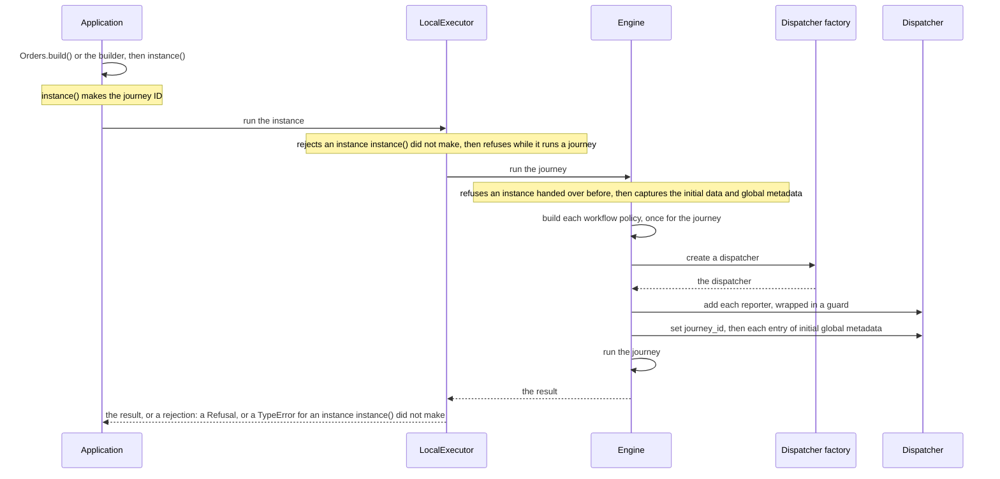

1. The application makes the workflow object with `Orders.build()`, or with the builder, and asks it for an instance. `instance()` makes the journey ID, from the ID generator, which may read the initial data, or as a random UUID.
2. The application hands the instance to `run` on a `LocalExecutor`. The executor rejects with a `TypeError` an instance that `instance()` did not make, which only a cast lets through. While it runs a journey, it refuses any other.
3. The engine refuses an instance that was handed to `run` before, refused or not. It captures the initial data and the initial global metadata, and refuses the instance when a value is not a value, or when the global metadata sets `journey_id`. Then it builds each workflow policy, once for the journey, and refuses the instance with `workflow policy failed` when one throws.
4. It creates the journey's dispatcher with the executor's dispatcher factory, the default one unless the executor was given another, and adds each reporter of the instance, wrapped in a guard.
5. It sets `journey_id` first, then each entry of the initial global metadata, in order, through the dispatcher.
6. A failure of the factory, of the dispatcher or of a reporter in steps 4 and 5 refuses the instance. A refusal rejects `run` with a `Refusal`, before any journey and any event.
7. Then the engine runs the journey, as the next section shows, and `run` resolves to its result: succeeded or failed with its data bag, or aborted. The application reads the result's output with `output`, giving a type for each key, as a typed read of the data bag does; it throws an `OutputError` for an aborted journey, which has no data bag, and for a key that holds no value or a value of another type.

Where it lives: `executor.ts`, `executor/local.ts`, `executor/refusal.ts`, `engine.ts`, `engine/start.ts`, `engine/policies.ts`, `journey/result.ts`, `journey/output.ts`.

### How a journey runs

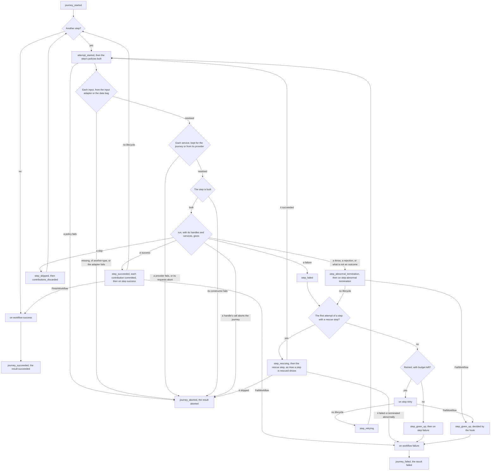

1. The engine emits `journey_started`, carrying the keys of the initial data, then attempts each step in the order the workflow declares them.
2. Each attempt emits `attempt_started`, then builds a new object of each of the step's policies, in order; one that throws aborts the journey with `policy could not be built`. Then it resolves the requests of the step's constructor, in the order it declares them, before the step exists:
    1. When an input adapter serves the step, the engine resolves the adapter's own requests, in order, and calls it, once for each input. Its access to the data bag is read-only and shows nothing once the call returns. A value it supplies is captured and emits `input_adapter_supplied`; `fromDataBag()` leaves the input to the data bag. A throw, a rejection, a return that neither `supply()` nor `fromDataBag()` made, or a supplied value that is not a value emits `input_adapter_failed` and aborts the journey with `step could not be built`, naming the adapter and the key.
    2. Otherwise the input is read from the data bag. Each requester gets its own copy, checked by the input's schema through the Standard Schema interface, and made an instance with `fromValue` wherever `classOf` names a class.
    3. A required input without a value aborts the journey with `required data missing`, and a value the schema refuses with `wrong type`, each naming the input adapter when the adapter made the request or supplied the value. An optional input without a value is `None`, and emits `optional_input_absent`.
    4. Then the engine resolves the services the step's `run` requests, in the order it declares them, as the section "How a service is lent" shows, so a step that cannot be built from its data never causes a provider to be called.
    5. Then the engine builds the step with its descriptor's `build`, giving the constructor the inputs. A constructor that throws aborts the journey with `step could not be built`.
3. The engine makes the attempt's handles, its contributor and its step reporter, and awaits the step's `run`, synchronous or asynchronous, lending it the handles and the services its `run` requests, in order, or, for an attempt a scripted run describes, what the script plays in its place:
    1. A contribution is captured when it is made, and kept until the attempt ends; the last value under a key wins.
    2. Every call on the step reporter, an event the step emits or an entry of global metadata it sets, runs once the calls made before it have settled, so a call the step does not await keeps its place. Its data is captured when the call is made. An entry of global metadata reaches the reporters, then emits `global_metadata_set`.
    3. A contribution, event data or global metadata that is not a value, global metadata under `journey_id`, or a reporter that fails on the step's event or entry, aborts the journey in that call's turn, and the call ends the step with the executor's signal, the journey-abort error, which the package never exports. A call made after the journey was aborted delivers nothing.
    4. Once `run` and every call it made have settled, the handles are closed: a call on a closed handle throws where it is made and changes nothing. If the journey was aborted during the attempt, whatever the step returned or threw is ignored, and the journey ends aborted.
4. What the attempt reported decides what follows:
    1. A success emits `step_succeeded`, then commits each contribution to the data bag, in the order its key was first contributed, emitting `contribution_committed`, and `data_overwritten` when it replaced a value. The engine goes on to the next step.
    2. A skip emits `step_skipped`, with its reason if it gave one, then `contributions_discarded`, and the engine goes on to the next step.
    3. A failure emits `step_failed` with its reason. A throw, a rejected promise, or anything returned that is not an outcome made by the helpers, is an abnormal termination, and emits `step_abnormal_termination` with the error's message. Neither commits what the attempt contributed.
    4. A failure or a skip whose reason was given details that are not a value aborts the journey with `not a value`, with no outcome reported.
5. Around these, the engine calls the hooks of the step's policies, as the next section shows. After a success, `on step success` runs once the attempt's contributions are committed: `FinishWorkflow` ends the journey as succeeded, and `FailWorkflow` as failed, with the step still succeeded. After an abnormal termination, `on step abnormal termination` runs, given no contributions, and `FailWorkflow` gives the step up at once.
6. After a failure or an abnormal termination the engine decides by its own rule. The first attempt of a step with a rescue step is handed to its rescue step, as the section "How a step is rescued" shows, and neither `on step retry` nor `on step failure` is called for it. The step is attempted again once its rescue step succeeded; a rescue step that fails or terminates abnormally fails the journey, and one that skips aborts it. Otherwise, while its retry budget allows another attempt, and, for an abnormal termination, while the step retries those, it calls `on step retry`, then emits `step_retrying` and attempts the step again, unless the hook returned `FailWorkflow`, which gives the step up at once, decided by the hook.
7. Otherwise it emits `step_given_up`: with the cause `failure` or `abnormal termination` when the step has no budget, or does not retry abnormal terminations, and `retries exhausted` when its budget is spent. Then it calls `on step failure`, whose `FailWorkflow` decides the journey's failure with its own reason.
8. Once the journey has failed, `on workflow failure` runs, then `journey_failed`, and the result is failed, with the last attempt's reason, its error as it was thrown, or the reason of the hook that failed it. Once no step is left, or a hook finished the workflow, `on workflow success` runs, then `journey_succeeded`, and the result is succeeded.
9. An abort, from an input, a service, a policy or a step that cannot be built, a handle's call, a hook, or a reporter that fails, ends the journey at once: the engine emits `journey_aborted`, and the result is aborted, with no data bag. No hook runs after an abort.

Where it lives: `engine/scan.ts`, `engine/policies.ts`, `engine/buildable.ts`, `engine/build.ts`, `engine/request.ts`, `engine/adapter.ts`, `engine/services.ts`, `engine/order.ts`, `value/read.ts`, `journey/data-bag.ts`, `engine/run.ts`, `engine/handles.ts`, `engine/outcome.ts`, `engine/outcome/failed.ts`, `engine/commit.ts`, `engine/decision.ts`, `engine.ts`, `step/outcome.ts`, `journey/result.ts`.

### How a step is rescued

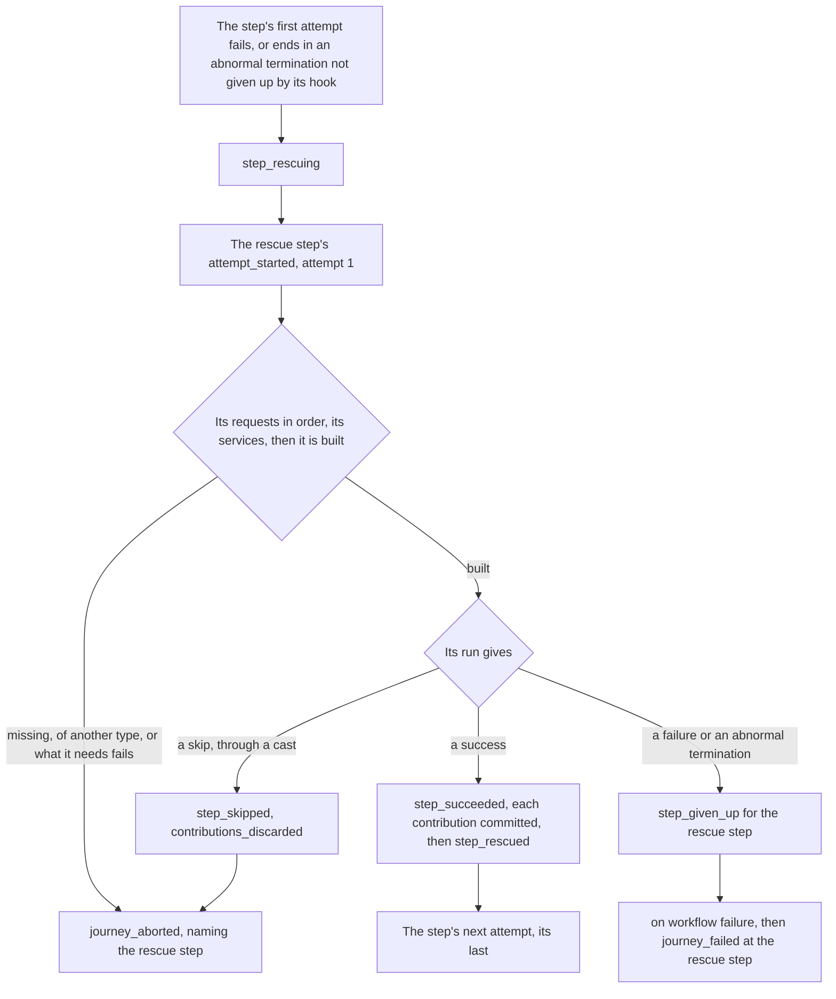

1. The engine's own rule hands the first attempt of a step with a rescue step to the rescue step, whether it failed or ended in an abnormal termination, and whatever the step says about retrying abnormal terminations. After an abnormal termination, `on step abnormal termination` runs first, and its `FailWorkflow` gives the step up instead. The workflow refuses a rescued step with a retry budget, so the first attempt is the only one handed over.
2. It emits `step_rescuing`, with the cause and the rescue step's name, decided by default, and calls neither `on step retry` nor `on step failure`. The failed attempt's contributions are not committed, but kept with its reason or its error for the rescue step.
3. The rescue step runs as its own attempt 1, under its own name, `<step name>_rescue`, which the journey names in its events and aborts: `attempt_started`, then its constructor's requests in the order it declares them. Its inputs come through the input adapter attached to its own name, which receives that name, or from the data bag, never through the adapter of the step it rescues. Data from the step it rescues is read from what the failed attempt contributed, as an input is, and the failure's reason and the error are given as its own copy; a required one that does not exist aborts the journey with `required data missing`, naming the rescue step. Its services come from the provider attached to its own name, or else the one attached to no step, and a provider of journey scope lends it the instance it made for the journey.
4. It is built and run as a step is, with no policies, so no step hook is called for it. A success emits `step_succeeded` and commits its contributions, then the engine emits `step_rescued`, naming the step, and attempts the step again as its next attempt, building its policies anew. With no retry budget, that attempt is its last: a failure or an abnormal termination there gives the step up under the ordinary rules, calling `on step failure`.
5. A rescue step that fails, or ends in an abnormal termination, emits `step_given_up` for itself, with the cause `failure` or `abnormal termination`, decided by default, and the journey fails at the rescue step, after `on workflow failure`, carrying its reason or its error. The step it rescues is never attempted again.
6. A rescue step that skips, which only a cast lets through, emits `step_skipped` and `contributions_discarded`, then aborts the journey with `rescue skipped`, naming the rescue step.
7. The engine builds and runs a step and a rescue step through one shape of its own, with the name, the requests, how to build it and, for a rescue step, what the failed attempt left, so building, services and running serve both.

Where it lives: `engine/outcome/failed.ts`, `engine/decision.ts`, `engine/scan.ts`, `engine/rescue.ts`, `engine/rescue/request.ts`, `engine/buildable.ts`, `engine/build.ts`, `engine/services.ts`, `engine/run.ts`, `engine/own-copy.ts`, `engine/request.ts`, `step/descriptor.ts`, `service/serving.ts`, `workflow/adapter.ts`.

### How a service is lent

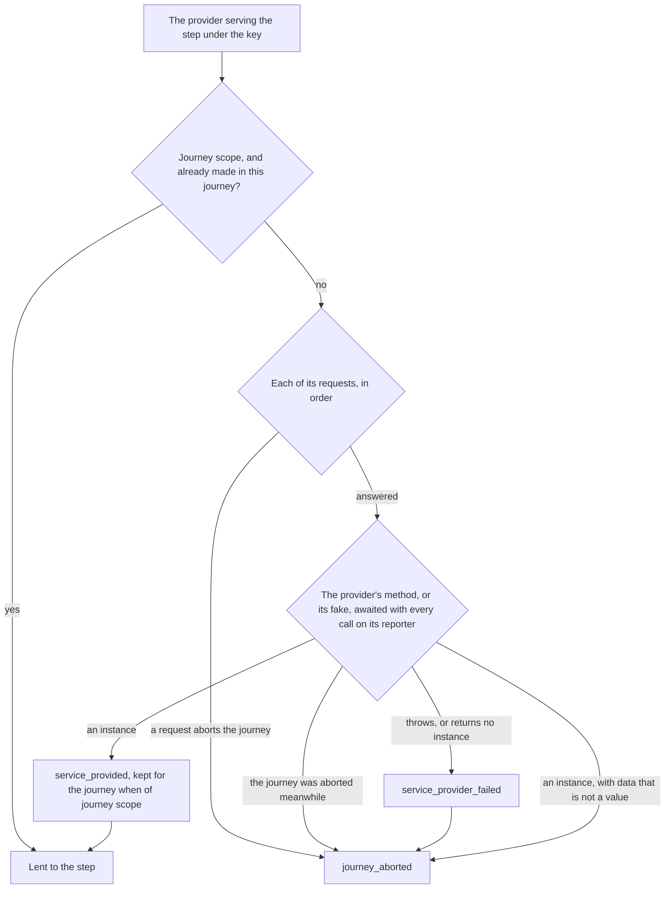

1. For each service the step's `run` requests, in the order it declares them, the engine finds the provider serving the step under the service's key: the one of that key attached to the step, or else the one of that key attached to no step.
2. A provider of journey scope is called the first time an attempt of a step it serves requests its key. The instance it made is kept on the journey, under the provider's name, and every later attempt of a step it serves receives it again with no event. Once the journey's result is made, however it ended, the engine clears what the journey kept, so no other journey ever receives an instance, and a handle an application keeps after the journey keeps none alive. A provider of attempt scope is called for every attempt that requests its key, and its instance is held only for that attempt.
3. Before the provider is called, the engine answers its requests in the order they are declared: the journey ID, data from the workflow, read from the data bag as a hook's is, the step's name, the attempt, and a provider reporter of its own, made by the same handles as a step's, whose events and global metadata name the provider, the step and the attempt. A required value that is missing or of another type aborts the journey, naming the provider and the key, and the provider is not called; an optional one without a value is `None`, and emits `optional_input_absent` naming the provider.
4. It calls the provider's method through the workflow descriptor's `provide`, on the workflow object, or, when a test gave the instance a fake for that provider with `fakeProvider`, the fake in its place, and awaits it and every call it made on its reporter, then closes the reporter. A journey aborted meanwhile, such as by a reporter failing on the provider's event, stands, and nothing the provider returned is looked at.
5. A throw, a rejection, or a return that `this.provide(...)` did not make emits `service_provider_failed` and aborts the journey with `step could not be built`, naming the provider, and carrying the error, or a `TypeError` saying what came back, `undefined` included.
6. Data supplied with the instance is captured; data that is not a value aborts the journey with `not a value`, naming the provider and `service_provided`, and no service event is emitted. Otherwise the engine emits `service_provided`, naming the implementation: the name of the instance's class, as the runtime reports it, or the service type's name for an instance with no class of its own, read without calling a getter, and carrying the data captured when the provider returned. The instance is then lent to the step's `run`, in the place the step requests it.

Where it lives: `engine/services.ts`, `engine/provider.ts`, `engine/provider/answer.ts`, `engine/handles.ts`, `engine/handles/holder.ts`, `engine/request.ts`, `service/serving.ts`, `service/implementation.ts`, `service/provider.ts`, `service/provider/provided.ts`, `workflow/descriptor.ts`, `instance/made.ts`.

### How a hook is called

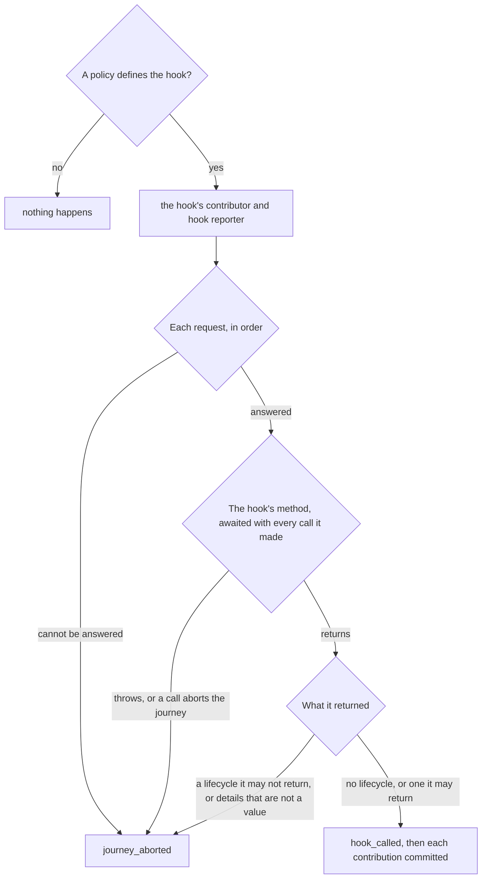

1. Since no two policies of a step, nor of the workflow, define the same hook, the engine calls a hook on the one policy object that defines it, built for the attempt or for the journey, or calls nothing.
2. It lends the hook a contributor and a hook reporter of its own, made by the same handles as a step's, which emit `journey_info`, `journey_warning` and `journey_error` and set global metadata in order, as a step reporter does.
3. It answers the hook's requests in the order they are declared: data from the step, read from what the attempt contributed, a failed attempt's included; data from the workflow, read from the data bag; the failure's reason and its error, each as the hook's own copy, the failure or retry cause, the step's name and the attempt; the journey ID; and, for a role, the workflow object. A required value that is missing, of another type, or a failure's reason or error that does not exist, aborts the journey as an input does; a request a hook of its kind is never answered, which only a cast lets through, aborts it with `hook failed`.
4. It calls the hook's method through the policy descriptor, awaits it and every call it made on its handles, then closes them, as a step's are closed. A throw or a rejection aborts the journey with `hook failed`, with its error, unless the journey was already aborted while the hook ran, which stands.
5. It checks what the hook returned, whatever a cast let through: nothing or `KeepDefault` keeps the default, `FinishWorkflow` is accepted only from `on step success`, and `FailWorkflow` only with a reason, from a step hook. Anything else aborts the journey with `invalid lifecycle`, and a reason's details that are not a value with `not a value`.
6. It emits `hook_called`, with the lifecycle a step hook returned, then commits what the hook contributed, emitting `contribution_committed` with the hook as its source.

Where it lives: `engine/hook.ts`, `engine/hook/answer.ts`, `engine/own-copy.ts`, `engine/request.ts`, `engine/hook/lifecycle.ts`, `engine/hook/step.ts`, `engine/hook/workflow.ts`, `engine/handles.ts`, `engine/handles/holder.ts`, `engine/commit.ts`, `policy/descriptor.ts`, `policy/lifecycle.ts`.

### Events and reporters

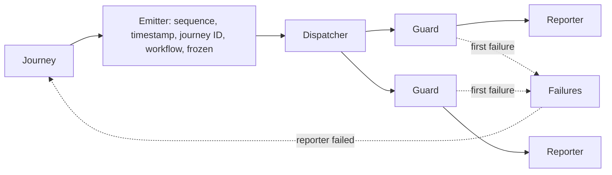

1. The journey makes each event with its emitter, which numbers the events of the journey from 1, stamps each with the time in ISO 8601 UTC, gives each the journey ID and the workflow's name, and freezes it with everything it carries.
2. It hands the event to the journey's dispatcher, which delivers it to each reporter through that reporter's guard, in the order the dispatcher chooses.
3. A guard passes on the failure of its reporter, and records it in the journey's failures, where the first failure stands.
4. When the dispatcher fails, or a reporter failed even though the dispatcher swallowed the failure, the journey is aborted with `reporter failed`, naming the step being run, if any.
5. Once a reporter failed, the guards let nothing through but `journey_aborted`, and nothing at all to a reporter that failed. A failure while `journey_aborted` is delivered is ignored, so it reaches the reporters after it.
6. Global metadata goes through the same guards, before the journey starts and while it runs, when a step or a hook sets an entry. A reporter or the dispatcher that fails on an entry while the journey runs aborts it with `reporter failed`, as on an event.

Where it lives: `engine/journey.ts`, `engine/emitter.ts`, `engine/guard.ts`, `engine/frozen.ts`, `report/default-dispatcher.ts`.

### How a scripted run plays

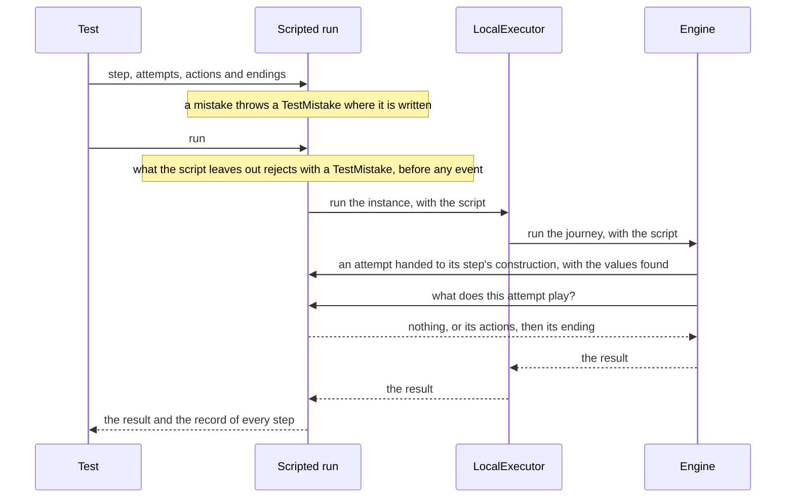

1. A test writes a script with `scripted(instance)`: the steps it names, the attempts it describes, what each does and how it ends. Each mistake that chapter 8 says is found where it is written, such as a name the workflow does not have or a contribution of a step with no contributor, throws a `TestMistake` from the call that writes it.
2. `run` first lists what the script leaves out, for each scripted step its first attempt not described and its rescue step when attempt 1 can fail, and every step when all were asked for, and rejects with a `TestMistake` listing them, before the journey and any event.
3. Otherwise it hands the instance to the local executor, the one given or a new one, with a `Scripting`, the engine's view of the script, through a private entry to the executor's run, which runs the journey as `run` does, refusals included.
4. For each attempt, the engine builds the step for real, its inputs, services and constructor included. Just before the constructor runs, it tells the script the attempt and the values its requests found: its inputs, and, for a rescue step, the contributions it requested of the failed attempt.
5. Then the engine asks the script what the attempt plays. An attempt not described, or described to run for real, calls the step's `run`. A described attempt plays its actions, in order, through the contributor and step reporter the attempt lends, then ends with the outcome its ending stands for, or a throw for an abnormal termination, so what follows is the engine's own, as for a real step.
6. The run resolves to the journey's result and the record of every step and rescue step of the workflow: the attempts handed to construction, each reading the values its step was built with.

The recorders lend the same handles outside any journey: each makes a lone journey whose dispatcher keeps what it is given, or fails on every call, and lends the handles the engine makes for it, so each handle behaves as in a journey.

Where it lives: `testing/scripted.ts`, `testing/scripted/attempt.ts`, `testing/scripted/writer.ts`, `testing/scripted/step-writer.ts`, `testing/scripted/target.ts`, `testing/scripted/checks.ts`, `testing/scripted/play.ts`, `testing/scripted/record.ts`, `testing/mistake.ts`, `executor/local.ts`, `engine/script.ts`, `engine/journey.ts`, `engine/build.ts`, `engine/run.ts`, `testing/recorders.ts`, `testing/lone.ts`.
